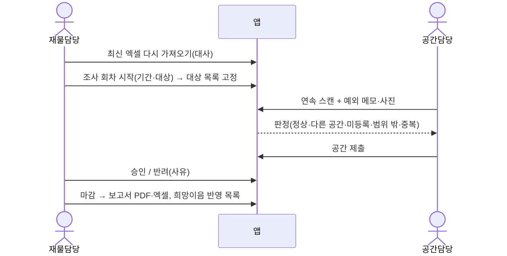

# 재물조사 앱 기획서 (초안)

## 1. 한 줄 요약

사회복지기관이 가입해서 쓰는 **무료 재물조사 웹앱**. 희망이음·자체 대장 엑셀을 올리면 QR 라벨을 뽑아 주고, 공간 담당자가 휴대폰으로 찍어 조사하고, 재물 담당자가 승인하면 연도별 결과 보고서가 남는다.

## 2. 왜 만드나

참고 자료 3곳(공유패키지 기관, 서울장애인일자리센터, 비콘)이 모두 같은 문제를 각자 따로 풀었다.

- 재물 담당자 혼자 모든 공간을 돌며 조사하기 어렵다.
- 희망이음 라벨에는 번호 글자만 있어 휴대폰으로 찍을 수 없다.
- 조사 결과가 엑셀·종이에 흩어져 지난해와 비교하기 어렵다.
- 기관마다 앱을 새로 만들 여력이 없다. → **한 번 만들어 여러 기관이 같이 쓴다** (차량운행일지와 같은 방식).

## 3. 핵심 가치 (모든 결정을 이 두 가지로 가른다)

- **정확성**: 값을 조용히 바꾸지 않는다. 누가·언제·어디서 찍었는지, 무엇을 왜 바꿨는지 남는다. 기관끼리 자료가 절대 섞이지 않는다.
- **편의성**: 엑셀에 있는 값은 다시 입력하지 않는다. 정상인 물건은 스캔 한 번으로 끝난다. 예외일 때만 입력을 받는다.

## 4. 사용자와 역할

차량운행일지의 역할 3종(`superAdmin`·`admin`·`employee`)을 그대로 쓰고, 공간 담당은 역할이 아니라 **공간에 사람을 지정**하는 방식으로 붙인다.

| 앱 역할 | 업무상 이름 | 할 수 있는 일 |
|---|---|---|
| 시스템 관리자 (`superAdmin`) | 서비스 운영자 | 기관 가입 승인·관리, 공지 |
| 기관 관리자 (`admin`) | 재물 담당자 | 엑셀 가져오기, 공간·담당자 지정, 라벨 인쇄, 조사 회차 열기·마감, 공간 결과 승인·반려, 보고서 |
| 직원 (`employee`) | 공간 담당자 | 지정된 공간의 대상 목록 보기, 스캔, 예외 메모·사진, 공간 결과 제출 |

**조사 방식은 기관이 설정에서 고른다.**

| 방식 | 흐름 | 맞는 기관 |
|---|---|---|
| 나눠서 조사 (기본) | 공간 담당자 스캔 → 공간 제출 → 재물 담당자 승인·반려 | 공간이 많거나 떨어진 시설이 있는 기관 |
| 혼자 조사 | 재물 담당자가 직접 스캔 → 바로 마감 | 작은 기관, 한 건물 |

재물 담당자가 공간 담당을 겸하면 자기 제출을 자기가 승인할 수 있되, 사유를 필수로 받고 보고서에 "본인 승인"으로 표시한다(공유패키지 결정 21 참고).

## 5. 첫 버전 범위 (조사 중심)

### 넣는 것

| ID | 기능 | 설명 |
|---|---|---|
| F01 | 기관 가입·직원 초대 | 차량운행일지 흐름 재사용: 기관 신청(고유번호증) → 시스템 관리자 승인 → 초대 코드로 직원 합류 |
| F02 | 기관 설정 | 조사 방식(나눠서/혼자), 기관명 표시. 라벨 기본 규격은 라벨 인쇄(F09)와 함께 3단계에서 |
| F03 | 공간 관리 | 공간 추가·이름·순서, 공간 담당자 지정(공간당 여러 명) |
| F04 | 엑셀 가져오기 | 희망이음 고정자산대장·자체 대장 `.xlsx/.xls`. **열 이름 자동 인식**(비콘 방식) + 못 알아본 열은 직접 연결, 연결 방법은 기관별로 저장 |
| F05 | 가져오기 검증·미리보기 | 자산코드 빈칸·중복, 건수·금액 합계, 상태(운영/불용/폐기)별 건수를 보여 주고 확인 후 확정 |
| F06 | 위치 → 공간 대응 | 엑셀의 위치 문자열 종류를 모아 앱의 공간에 연결(자동 제안 + 재물 담당자 승인) |
| F07 | 다시 가져오기(대사) | 새 엑셀을 올리면 **신규 / 바뀜 / 엑셀에서 사라짐**을 나눠 보여 준다. 사라진 재물을 조용히 지우지 않는다 |
| F08 | 재물 목록·상세 | 공간·상태·조사상태로 거르기, 코드·이름 검색. 넓은 화면은 표, 휴대폰은 카드 |
| F09 | QR 라벨 인쇄 | A4 라벨지 규격 몇 종(폼텍 3218 등) + 직접 치수, 건너뛸 칸, 재단선, 공간별·선택·1장 재발급. 라벨: 기관명·자산코드(크게)·품명·QR |
| F10 | 조사 회차 | 이름(예: 2027년 정기 재물조사)·기간·대상 공간을 정하고 시작. **시작 시점의 대상 목록을 고정**. 지난 회차는 지우지 않고 보관 |
| F11 | 현장 스캔 | 연속 스캔. 판정: 정상 / 다른 공간 / 미등록 / 범위 밖(불용·폐기) / 중복(수 늘지 않음) / 직접 입력(재확인 표시). 카메라 안 되면 코드 직접 입력·바코드 스캐너 |
| F12 | 물건 상태 표시 | 스캔한 물건에 `정상 / 파손·불용 필요 / 라벨 훼손` 선택, 예외만 메모·사진 |
| F13 | 공간 제출·승인 | 나눠서 조사 방식일 때 공간별 제출 → 승인·반려(사유 필수) |
| F14 | 현황판 | 전체·공간별 진행률, 미조사·다른 공간·파손 건수, 남은 기간(D-day), 최근 스캔 |
| F15 | 마감·결과 보고서 | 마감하면 연도별로 보관. 종합·공간별·파손/불용·위치 다름·미발견 표, **PDF·엑셀** 내려받기 |
| F16 | 희망이음 반영 목록 | 조사로 드러난 위치 변경·불용 후보를 "희망이음에 옮겨 적을 일" 목록으로. 반영 완료 체크 |
| F17 | 변경 이력 | 가져오기·위치 확정·승인 등 모든 변경을 전·후 값, 사람, 시각, 사유와 함께 생성만 가능한 기록으로 |

### 다음 버전으로 미루는 것

공간 이동 신고·인수, 불용→폐기 처리, 자산관리카드 사진 일괄 가져오기, 알림톡·푸시, 정·부 관리자 일괄 지정. (재물 직접 등록·수정과 간단한 자동 번호는 2026-11-22에 넣었다 — 결정기록 참고.)

미루는 이유: 첫 버전은 "희망이음이 원장, 앱은 조사 도구"로 두면 기관이 부담 없이 시작할 수 있다. 관리 도구로 넓히는 건 시범 기관 반응을 보고 정한다.

## 6. 핵심 흐름

### 처음 시작 (기관당 1회)

### 연 1회 조사

## 7. 데이터 설계 (초안)

차량운행일지처럼 **최상위 컬렉션 + 모든 문서에 `organizationId`** 를 두고, 보안 규칙과 ESLint 규칙(`require-organization-filter`)으로 기관 격리를 이중으로 강제한다.

| 컬렉션 | 내용 |
|---|---|
| `organizations` | 기관 정보(차량운행일지 재사용) + `surveyMode: 'delegated' \| 'solo'`, 라벨 기본값, 열 연결 저장값 |
| `users` | 차량운행일지 재사용 |
| `spaces` | 이름, 순서, 담당자 uid 목록, 원본 위치 문자열 목록 |
| `assets` | 문서 ID `기관ID__자산코드`. 품명·분류·규격·취득일자·수량 등 엑셀 값, 상태(운영/불용/폐기)와 원문, `spaceId`, 원본 위치, 대장에 없음 표시. `tagId`(QR 라벨 번호, 3단계). (4단계: 마지막 확인) |
| `assetAccounting` | 재물과 같은 문서 ID. 자산금액·감가상각충당금·잔존가액 — 관리자만 |
| `imports` | 가져오기 회차: 파일명·시트, 열 연결, 건수·금액, 대장 합계 줄 금액, 신규/바뀜/사라짐/그대로 건수, 확정자 |
| `surveys` | 회차: 이름, 기간, 대상 공간(+공간 미지정 포함 여부), 시작 시점 조사 방식, 상태(진행/마감), 대상 수. 마감 때 마감자·시각·공간 이름·요약 숫자 |
| `surveySubmissions` | 공간 제출·승인 (`회차__공간`): 제출·승인·반려, 사유, 본인 승인·대신 승인 표시 |
| `surveyEvents` | 조사 이력(생성만): 시작·제출·승인·반려·마감·반영 처리, 사람·시각·사유 |
| `surveyTargets` | 회차 시작 시 고정한 대상 목록. **공간별 묶음 문서**(재물 1건당 문서 1개로 만들지 않아 쓰기 비용을 줄임) |
| `scans` | 문서 ID `회차__재물`(미등록은 `회차__u__코드`) — 같은 물건은 문서 하나. 찍은 공간·있어야 할 공간, 판정, 직접 입력 여부, 물건 상태·메모, 사람, 시각. (사진은 나중) |
| `history` | 변경 이력. 생성만 가능 |
| `syncTasks` | 희망이음 반영 목록 (마감 때 생성): 위치 변경·불용 검토·미발견·등록·라벨, 처리 완료 체크 |

QR에 담는 값 (3단계에서 확정): 
- `https://<서비스주소>/t/<태그ID>` 형태의 주소. 휴대폰 기본 카메라로 찍어도 앱의 해당 재물이 열리고, 태그 ID만으로는 기관·물건을 알 수 없다.
- 이미 QR 라벨을 붙인 기관(예: 관리번호만 담긴 QR)도 있으니, 스캔 때 태그 ID로 못 찾으면 **같은 기관의 자산코드로 다시 찾는다**.

## 8. 기반: 차량운행일지 보일러플레이트

**방식(추천)**: 차량운행일지를 통째로 복사한 뒤 차량 업무를 걷어내고, 빌드·테스트가 통과하는 상태를 확인한 다음 재물 업무를 얹는다.
- git 이력은 새로 시작한다(차량 Phase 이력 141개는 가져오지 않음).
- Firebase 프로젝트는 새로 만들고, `.env`·서비스 키는 복사하지 않는다.

골라서 옮기는 방식보다 이쪽을 고른 이유는 로그인·기관 승인·권한이 여러 곳(서버 함수 트리거, 커스텀 클레임, 보안 규칙, 인덱스, E2E)에 나뉘어 있기 때문이다. 골라 옮기다 빠뜨리면 조용히 깨진다. 통째로 복사하면 처음부터 돌아가는 상태에서 하나씩 빼며 확인할 수 있다.

| 남긴다 | 걷어낸다 |
|---|---|
| 로그인·랜딩·기관 신청(고유번호증 AI 확인)·초대 코드·승인 대기·약관·개인정보처리방침·FAQ·업데이트 소식 | 차량·예약·운행일지·주유·하이패스·정비 |
| 시스템 관리자 기관 승인 화면, 직원 관리, 설정 틀, 감사 로그 뷰어, 기관 탈퇴 | 구글 캘린더·TMAP 길안내·Slack 어시스턴트 |
| `organizations`·`users`·`auditLogs`·`notifications`·`feedbacks`·`broadcasts`, 행위자 스탬프 | 계기판 OCR(기관 인증 OCR은 남김), 운행 통계·차트 |
| 커스텀 클레임 동기화, 감사 로그 트리거, 보안 규칙 헬퍼(`isOrgMember` 등) | 공휴일 캐시, 예약 알림 배치 |
| 디자인 시스템(Tailwind·다크 모드·글꼴 크기), PWA·설치 안내, 인앱 브라우저 경고, 오프라인 배너, 오류 경계 | 차량 관련 PDF 양식(내보내기 패턴은 남김) |
| ESLint `require-organization-filter`, Vitest·Playwright·규칙 테스트, commitlint, CI·배포 워크플로, `.agent` 하네스, Sentry, App Check | 알림톡은 끈 채로 남길지 결정 필요 |

## 9. 기술 구성

| 영역 | 선택 | 메모 |
|---|---|---|
| 화면 | React 19 + Vite + TypeScript + Tailwind v4 + Zustand | 차량운행일지와 같음 |
| 서버 | Firebase Auth·Firestore(서울)·Storage·Functions·Hosting | 새 프로젝트, Blaze + 예산 알림 |
| 엑셀 읽기 | **브라우저에서** SheetJS로 읽음 | 기관마다 PC에 프로그램 설치를 요구할 수 없음. 원본 파일은 서버로 보내지 않고 값만 저장 |
| QR 읽기 | 브라우저 카메라 + html5-qrcode 계열 | iPhone Safari 포함. HTTPS 필수 |
| QR 만들기 | 브라우저에서 직접 생성 | 외부 QR 서비스로 코드를 보내지 않음(itemmanager 교훈) |
| 보고서 | PDF·엑셀 | 차량운행일지 `data-export-pattern` 재사용 |
| 오프라인 | Firestore 오프라인 캐시 | 지하·창고 등 전파 약한 곳에서 스캔 후 자동 전송. 시범 때 실제 확인 필요 |

## 10. 비용 원칙

여러 기관이 한 프로젝트를 같이 쓰므로 무료 사용량을 기관 수로 나눠 쓰는 셈이다.

- 조사 대상 고정은 공간별 묶음 문서로 만든다(1,000건 기관도 문서 수십 개).
- 현황판 숫자는 첫 버전에서는 현황판을 연 동안 스캔을 실시간으로 읽어 화면이 계산한다(5단계 결정 — 단순하고 틀릴 일이 없다). 기관이 늘어 읽기가 커지면 회차 문서 집계(서버 함수)로 바꾼다. 마감한 회차의 요약 숫자는 회차 문서에 남긴다.
- 사진은 예외 증빙만, 줄여서 올린다.
- 차량운행일지 `firebase-cost-reduction` 스킬과 비용 분석 문서를 따른다.

## 11. 진행 단계

| 단계 | 내용 | 끝났다는 기준 |
|---|---|---|
| 0 | 보일러플레이트 정리: 복사 → 차량 업무 걷어내기 → 이름·도메인 바꾸기 → 새 Firebase 연결 | 빌드·린트·타입·규칙 테스트 통과, 기관 가입→승인→직원 초대가 새 프로젝트에서 동작 |
| 1 | 기관 설정·공간·담당자 (F02·F03) | 공간은 같은 기관만 읽고 관리자만 쓰는 규칙 테스트 통과. "공간 담당자는 자기 공간만" 경계는 조사 대상·스캔이 생기는 4단계에서 건다 |
| 2 | 엑셀 가져오기 (F04~F07) | **협력 기관 실제 파일**로 건수·금액 대사 일치, 다시 가져오기에서 신규·바뀜·사라짐 구분 |
| 3 | 재물 목록·상세·라벨 (F08·F09) | 실제 라벨지에 인쇄해 위치 맞음, Android·iPhone에서 읽힘 |
| 4 | 조사 회차·스캔 (F10~F12) | 판정 6종이 모두 재현됨, 중복 스캔이 수를 늘리지 않음 |
| 5 | 제출·승인·현황판·마감·보고서·반영 목록 (F13~F17) | 두 방식(나눠서/혼자) 모두 처음부터 끝까지 동작 |
| 6 | 협력 기관 시범 | 공간 2곳 리허설: 정상, 다른 공간, 미등록, 라벨 훼손, 인터넷 끊김을 실제로 재현. 준비물·순서는 [시범운영안내.md](시범운영안내.md), 배포 준비는 [OPERATIONS.md](OPERATIONS.md) 2장 |

## 12. 수용 기준

- 다른 기관의 재물·스캔·사람이 어떤 경로로도 보이지 않는다(규칙 테스트로 확인).
- 희망이음 엑셀을 올리면 열 순서가 달라도 핵심 열(자산코드·자산명·위치·상태·취득일자·금액)을 알아본다.
- 가져오기 전후 건수·금액이 원본과 같아야만 확정된다.
- 다시 가져오기에서 엑셀에 없는 재물을 조용히 지우지 않는다.
- 다른 공간에서 찍으면 즉시 "다른 공간"으로 표시된다.
- 같은 물건을 여러 번 찍어도 조사 수가 늘지 않는다.
- 직접 입력한 항목은 "스캔 확인"과 구분되어 재확인 대상으로 남는다.
- 마감한 회차의 보고서는 나중에 다시 열어도 마감 시점 그대로다.
- 누가 언제 어떤 공간에서 무엇을 찍고, 승인하고, 바꿨는지 추적된다.

## 13. 정할 것

| 항목 | 추천안 |
|---|---|
| QR에 담을 값 | **확정(3단계)**: 서비스 주소 + 무작위 태그 ID(재물 문서의 `tagId`), 못 찾으면 자산코드로 재검색(4단계) |
| 기관 가입 인증 | 차량운행일지와 같게(고유번호증 AI 확인 + 시스템 관리자 승인) |
| 기본 라벨 규격 | **확정(3단계)**: 공유패키지에서 인쇄·판독을 확인한 3종(작은·중간·큰, 기본 중간 21칸) + 직접 치수. 시범 기관 라벨지 규격은 받는 대로 추가 |
| 관리번호 규칙 | 기관이 쓰던 자산코드를 그대로 쓴다(새로 매기지 않음) |
| 서비스 주소 | socialprism.co.kr 아래 새 주소 |
| 알림톡 | 첫 버전은 끄고 코드는 남김 |
| 불용·폐기 재물 | 가져오되 조사 대상에서는 빼고, 찍히면 "범위 밖"으로 알려 줌 |
| 앱 이름 | 미정 |

## 14. 협력 기관에 받을 자료

1. 희망이음 고정자산대장 엑셀
2. 희망이음 자산관리카드 엑셀 몇 개(사진 포함)
3. 기관 자체 대장(엑셀·구글 시트)
4. 지금 붙어 있는 라벨 사진 1~2장, 쓰는 라벨지 규격

직원 실명·연락처·계정 열은 지우고 받는다.
